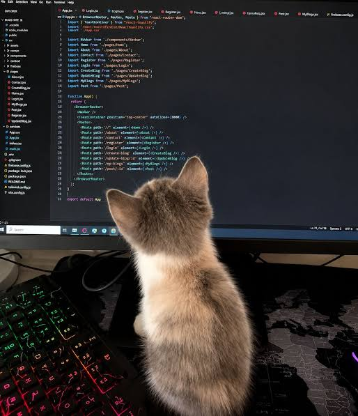

# Hi there, I'm Emanuel Hernández 👋

🎓 **Computer Technologies Engineering Student** @ Tec de Monterrey  
✈️ Currently on Academic Exchange @ **Universiti Malaya** (Kuala Lumpur, Malaysia 🇲🇾)  
🚀 Co-founder & Full-Stack / Mobile Developer  

---

### 💻 About Me

- 🛠️ **Building:** Mobile & Web apps with **Flutter**, **React**, **NestJS**, **Node.js**, and **Supabase/PostgreSQL**.
- ☁️ **Exploring:** Cloud infrastructure (AWS Lambda, Cognito, API Gateway), Docker, and AI-assisted workflows.
- 📐 **Focus Areas:** Software Quality, Requirements Engineering (IEEE Standards), and System Architecture.
- 🎨 **Creative Outlets:** 3D Modeling & VFX (Blender, Maya, TouchDesigner) & Indie Game Dev (Unity, Roblox Studio).
- 🏆 **Background:** Competitive springboard diving alum & competitive programming enthusiast.
- 🧗 **Outside of Code:** Indoor bouldering, swimming, music production/discovery (breakcore, emo-trap, alt-rock), and traveling.

---

### 🛠️ Tech Stack & Tools

| Domain | Technologies & Tools |
| :--- | :--- |
| **Languages** | TypeScript, JavaScript, C++, Python, Dart, SQL |
| **Frontend & Mobile** | Flutter, React, Tailwind CSS |
| **Backend & Cloud** | NestJS, Express, Node.js, AWS (Lambda, Cognito, API Gateway), Docker |
| **Databases** | PostgreSQL, Supabase, MongoDB |
| **3D, Visuals & Dev** | Maya, Blender, TouchDesigner, Unity, Figma, Git/GitHub, Cursor |

---

### 🚀 Projects & Highlights

* **Glup** — Co-founder & lead developer for a mobile social discovery and ticketing platform built with Flutter, NestJS, and Supabase.
* **SOEM-CEDI / verticheIntelligence** — RFID-based logistics monitoring dashboard built with NestJS, React, PostgreSQL, and WebSockets.

---

### 📬 Connect with Me

- 🌐 **GitHub:** [@a01752433](https://github.com/a01752433)

- 
